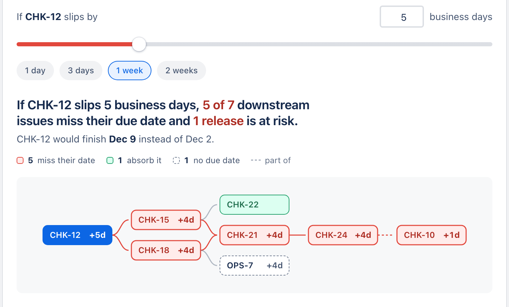

# Knock-On

**If this Jira issue slips, what else breaks?**



Every standup has the line "this one will be a few days late". Nobody in the room can say which other work, which release and which people that touches, so the knock-on effect is found a week later. Knock-On is an Atlassian Forge app that answers it in Jira, on the issue itself, from the dependency links the team already keeps.

## What it does

- **Jira issue panel.** Open an issue, set how many business days it may slip (slider, number field or quick picks), and see:
  - one sentence with the damage: how many downstream issues miss their due date and how many releases are at risk;
  - a dependency graph of everything downstream, coloured by outcome, with the red spreading column by column as you change the slip;
  - releases (fix versions) whose last issue now lands after the release date, and which issue drives it;
  - each broken due date with its owner and new finish date, what absorbs the slip and how much slack is left, work that was already late before the slip, and work with no due date;
  - who to tell;
  - one button that posts the forecast to the issue as a comment.
- **Rovo agent "Knock-On"** with two actions:
  - `forecast-slip-impact(issueKey, slipDays)`: the same forecast as text;
  - `find-schedule-conflicts(projectKey)`: dependencies whose dates already contradict each other before anything slips (a blocker due too late for the work it blocks, or a child due after its parent).
- **Rovo MCP server** (`rovo:mcp` module) exposing the same two actions as tools.

### How the forecast works

All in business days (Monday to Friday):

1. Walk downstream from the issue: issues it **blocks** (also the "depends on" link type, read in the right direction) and its **parent** (a parent finishes only when its children do). Finished issues stop the walk.
2. Fetch the *other* blockers of everything found once, so their due dates still constrain the work they block.
3. In topological order: `finish(v) = latest of (v's due date, finish(blocker) + duration(v) for each blocker, finish(child) for each child, today)`, where duration is the original estimate in 8-hour days, or 1 day.
4. Run it twice, with no slip and with the slip, so "newly late because of this slip" is separated from "already late in the plan".
5. Dependency loops are detected and left out; graphs over 80 issues are cut and flagged.

## Run it locally

Needs Node.js 22 or later.

```bash
npm install
npm test            # 28 unit tests: dates, Jira parsing, crawl, forecast, conflicts, handlers
npm run build       # builds the Custom UI into static/panel/build
npm run validate    # Forge manifest validation + Forge lint rules, offline (needs the build)
npm run preview     # local preview at http://localhost:5178
```

`npm run preview` serves the panel with the real handlers running against an in-memory Jira holding a sample "Checkout 2.0" project. Try `?issue=CHK-12` (the main chain), `?issue=CHK-21`, `?issue=CHK-30` (nothing depends on it), `?issue=CHK-11` (done). The page also has a runner for the two Rovo action / MCP tool functions and shows the comments the in-memory Jira received. Dates are relative to today, so the sample never goes stale.

Demo video (`assets/demo-jira.mp4`): `node scripts/capture-preview.mjs` (with the preview running) captures the slider drag frame by frame, with CSS animations slowed through the DevTools protocol so the ripple is caught at every step; `node scripts/record-jira-demo.mjs` then renders the video at 1920x1080, 60 fps from those frames and full-resolution captures of the app in Jira (`assets/raw/jira-live/`), with an eased zoom-to-focus camera, cursor, captions and a Kokoro TTS voice-over (set `KOKORO_PYTHON` and `TTS_SCRIPT`). Needs `ffmpeg`. `npm run demo` records the older preview-only walkthrough `assets/demo.mp4`.

## Deploy to Jira

Needs a free Atlassian developer site and the Forge CLI, which requires Node `^22.23.4`, `^24.22.1` or `>=26.12.1`.

```bash
npm install -g @forge/cli
forge login
forge register          # replaces the placeholder app id in manifest.yml
npm run build
forge deploy
forge install           # choose Jira and your site
```

Then open any Jira issue that blocks other issues; the **Knock-On** panel is under the issue's apps button. In Rovo chat, pick the **Knock-On** agent.

Scopes: `read:jira-work` (read issues and links), `write:jira-work` (post the forecast comment, only when the button is pressed). Requests run as the current user, so Knock-On only sees issues that user can see.

## Project layout

| Path | What |
|---|---|
| `manifest.yml` | Forge modules: `jira:issuePanel`, `rovo:agent`, two `action`s, `rovo:mcp`, three functions |
| `src/core/` | Business-day dates, forecast engine, conflict finder, text and Atlassian Document Format output |
| `src/jira/` | Jira REST parsing (`issuelinks`, parent, estimates, fix versions) and the downstream crawl via `POST /rest/api/3/search/jql` |
| `src/handlers.js` | Panel resolvers and action handlers, with the Jira client injected |
| `src/index.js` | Forge wiring: `@forge/resolver`, `api.asUser().requestJira` |
| `static/panel/` | Custom UI (Vite, no framework): controls, summary, SVG graph, lists |
| `agent/prompt.md` | Rovo agent instructions |
| `harness/` | In-memory Jira and sample project for tests and the local preview |
| `scripts/` | Offline manifest validation + lint, demo recorder |
| `DESIGN.md` | Visual system and motion |

## Known limits

- Seen working on a Jira Cloud test site (development build): the issue panel, its forecast on a 6-issue dependency chain, posting the comment, and navigating between issues. The Rovo agent and the MCP tools have not been exercised live (Rovo is not enabled on the test site); they run the same handlers the tests cover.
- Business days exclude weekends only; public holidays and individual calendars are not considered.
- Durations come from the original estimate, not remaining estimate or story points; issues with no estimate count as 1 day.
- An epic's children are reached only when they are downstream of the slipping issue; other children of the same epic are not fetched.
- Start dates and Jira Plans data are not used.
- Crawl limit: 80 downstream issues plus 50 outside blockers per forecast.

## Licence

MIT
